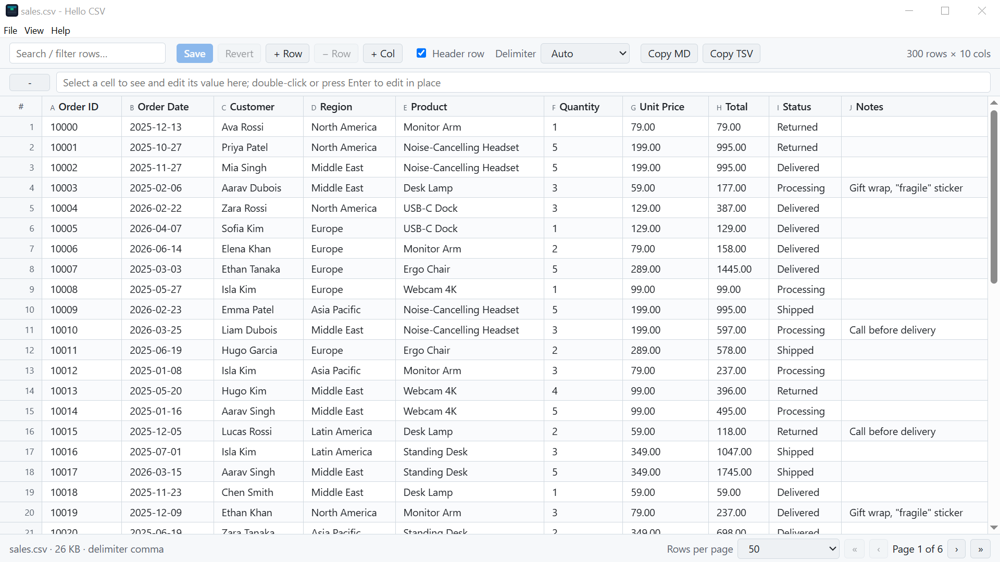
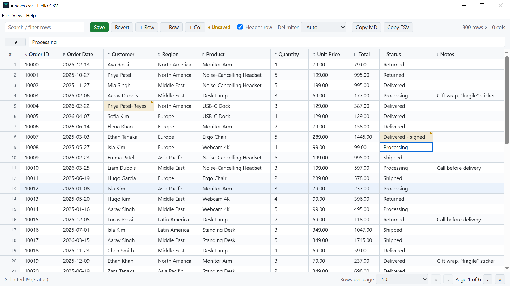
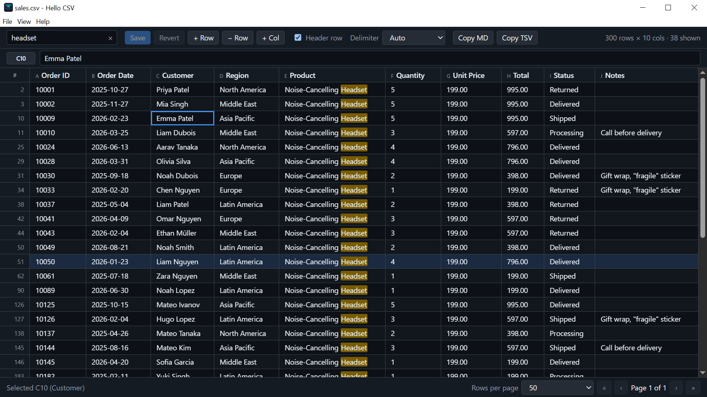
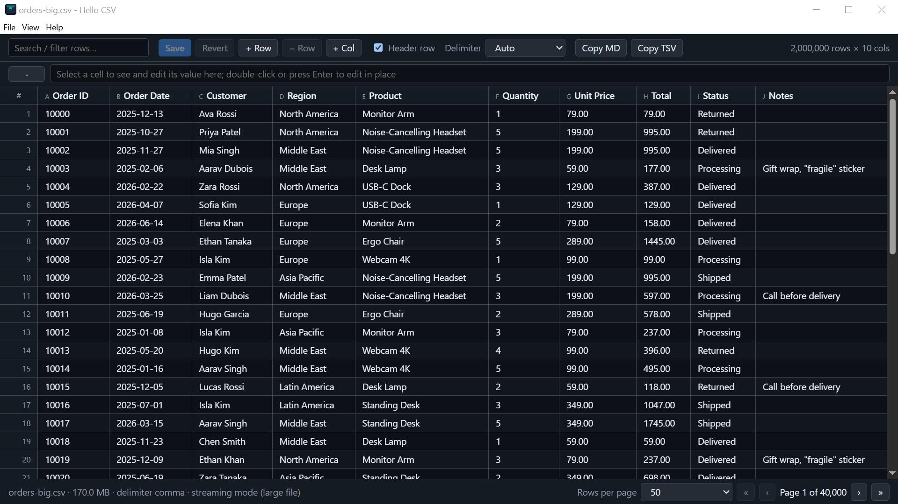
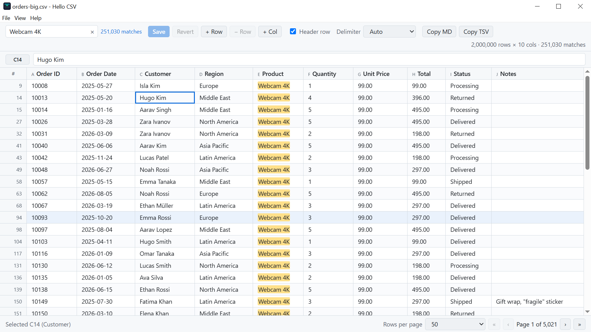

# Hello CSV

A tiny, fast CSV / TSV viewer and editor for Windows (Linux and macOS build from the same source). The release binary is
under 1 MB because it uses the operating system's webview (WebView2 / WebKitGTK / WKWebView) instead of bundling a browser,
and it reads big files from disk instead of loading them into memory.

It is the desktop sibling of the [Hello CSV VS Code extension](https://github.com/sunaram/hello-csv) and of `mdv`, the Markdown viewer.

## Features

- **Huge files:** files over 5 MB open in streaming mode: the first page appears immediately while a background thread builds a
  sparse row index; paging jumps straight to any row, search streams matches from disk, and saving rewrites only the edited rows
  through a temp file (constant memory, every untouched byte is copied as-is). A 94 MB / 1.5 M row file is browsable at once.
- **Editing:** double-click, Enter or F2 to edit, or just start typing; formula-style value bar; Tab / Enter navigation, arrow keys,
  Delete to clear; undo / redo; amber markers on changed cells; insert / delete rows and add columns (files under 5 MB);
  double-click a header to rename it; Save (Ctrl+S) writes RFC 4180 CSV, keeping delimiter, line endings and BOM.
- **Exploring:** sticky header and row numbers, click-to-sort (numeric aware), instant search with highlighting, paging (25 to 10,000 rows),
  delimiter auto-detection (comma, semicolon, tab, pipe) with override, header-row toggle, Copy as Markdown / TSV.
- **Desktop:** open dialog, drag and drop, file association, recent files, live reload when the file changes on disk,
  light / dark / system theme, zoom (all remembered).
- **Updates:** downloadable builds check GitHub Releases once a day and show a notice (Help menu to turn off or check now);
  Microsoft Store builds never do, the Store updates them.



| | |
|---|---|
|  |  |
|  |  |

## Install

Downloads are on the [Releases page](https://github.com/sunaram/hello-csv-desktop/releases/latest):

| File | For |
|---|---|
| `hellocsv.exe` | Windows, portable (needs the WebView2 runtime, preinstalled on Windows 11); `install.ps1` registers the `.csv` / `.tsv` / `.tab` association |
| `hellocsv.msix` | Windows package |
| `hellocsv-linux-x86_64.tar.gz` | Linux, with `install.sh` for a per-user install (registers the CSV / TSV associations) |
| macOS `.dmg` | macOS (universal, ad-hoc signed: right-click > Open the first time) |

## Shortcuts

| Shortcut | Action |
|---|---|
| Ctrl+O / Ctrl+R / F5 | open / reload from disk |
| Ctrl+S | save |
| Ctrl+F | focus the search box |
| Enter / F2 / double-click, or type | edit the selected cell (Esc cancels, Tab moves on) |
| Arrows, PageUp / PageDown | move the selection / change page |
| Ctrl+Z / Ctrl+Y | undo / redo |
| Ctrl+C | copy the selected cell |
| Ctrl + `+` / `-` / `0` | zoom |

(Cmd instead of Ctrl on macOS.) Settings live in `%APPDATA%\hellocsv`.

## Build

```sh
cargo build --release          # Linux needs libwebkit2gtk-4.1-dev libgtk-3-dev libxdo-dev
cargo test                     # parser, index, paging, search and delta-save tests
target/release/hellocsv samples/customers.csv
```

Windows Store package: `powershell -File packaging/msix/build.ps1` (see the header of that script for the Partner Center values).

Store art and screenshots: `packaging/msix/gen-store-art.ps1`, `tools/screenshot.ps1`; listing text in
`packaging/msix/store-listing.md`. Privacy policy: [PRIVACY.md](PRIVACY.md).

## Layout

| File | Purpose |
|---|---|
| `src/csv.rs` | parser, delimiter sniffing, sparse index, paging, streaming search, delta save |
| `src/main.rs` | window, menu, settings, custom protocol (`/__open`, `/__page`, `/__search`, `/__status`), saving |
| `assets/` | `body.html`, `style.css`, `app.js`: the whole UI, embedded in the executable |
